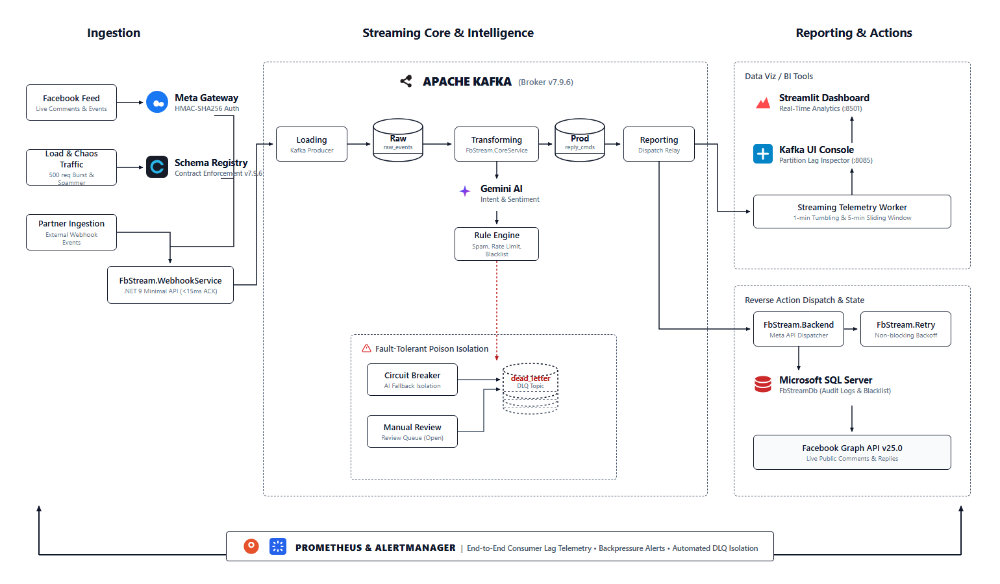

# ⚡ FbStream: Event-Driven Streaming Data Platform & Real-Time Analytics

[](.github/workflows/ci.yml)
[](https://kafka.apache.org/)
[](https://dotnet.microsoft.com/)
[](https://www.python.org/)
[](https://streamlit.io/)
[](https://docs.confluent.io/platform/current/schema-registry/)
[](https://prometheus.io/)
[](https://www.docker.com/)

**FbStream** là nền tảng xử lý dữ liệu dòng phân tán (Event-Driven Streaming Platform) kiến trúc **Dòng Kép (Dual-Stream Architecture)**:
1. **Operational Stream (.NET 9 Microservices):** Tiếp nhận luồng Webhook thời gian thực từ Meta/Facebook Graph API, xác thực chữ ký HMAC-SHA256, kiểm duyệt nội dung tự động qua Google Gemini AI, tự động phản hồi bài viết và quản lý lỗi phân tán với **Idempotent Consumers**, **Circuit Breaker**, **Non-blocking Exponential Backoff Retry** và **Dead Letter Queue (DLQ)**.
2. **Analytical Stream (Python + Streamlit):** Tiêu thụ song song dòng sự kiện từ Kafka để tính toán chỉ số theo cửa sổ thời gian (**1-minute Tumbling Window** cho tốc độ & phát hiện đột biến Anomaly Spike; **5-minute Sliding Window** cho xu hướng cảm xúc) và trực quan hóa tức thời trên **Streamlit Real-Time Dashboard**.

---

## 🏛️ Kiến trúc Hệ thống (System Architecture)

<div align="center">
  
</div>

---

## 🌟 Điểm Nhấn Kỹ Thuật (Key Engineering Highlights)

### 1. Delivery Semantics & Chống Trùng Lặp (Idempotency)
* **At-Least-Once Delivery:** Kafka đảm bảo toàn vẹn dữ liệu dòng, không làm rơi rụng sự kiện ngay cả khi rebalance hoặc dịch vụ khởi động lại.
* **Exactly-Once Processing at Business Layer:** Dịch vụ `FbStream.BackendApi` sử dụng cơ chế **Idempotency Key locking** trên SQL Server (`WITH (UPDLOCK, HOLDLOCK)`). Khi một tin nhắn bị redeliver, hệ thống lập tức loại bỏ trùng lặp và bỏ qua, đảm bảo bình luận phản hồi người dùng chỉ được gửi lên Facebook đúng 1 lần duy nhất.

### 2. Khả Năng Chịu Lỗi & Cách Ly Tin Nhắn Độc (Resilience & DLQ)
* **Phân loại lỗi thông minh:**
  * *Lỗi tạm thời (Transient):* Mạng chập chờn, timeout, HTTP 429 (Too Many Requests), HTTP 5xx $\rightarrow$ Cho phép thử lại.
  * *Lỗi cố định (Permanent):* HTTP 401 Unauthorized (sai token) $\rightarrow$ Cách ly lập tức sang Dead Letter Queue, không thử lại vô ích.
* **Non-blocking Asynchronous Backoff:** `FbStream.RetryService` tính toán độ trễ lũy thừa ($1s \times 2^{\text{retry\_count}}$) và điều phối bất đồng bộ, giải phóng hoàn toàn vòng lặp Kafka Consumer để duy trì thông lượng tối đa.
* **Dead Letter Queue (DLQ):** Sau 3 lần thử lại thất bại, sự kiện được đóng gói thành `DeadLetterEvent` và đẩy vào topic `dead_letter` để bảo vệ hệ thống và kích hoạt cảnh báo SRE.

### 3. Quản Trị Hợp Đồng Dữ Liệu (Data Contracts & Schema Registry)
* Tích hợp **Confluent Schema Registry** kiểm soát cấu trúc dữ liệu trên các topic `raw_events` và `reply_commands` theo chuẩn tương thích `BACKWARD`.
* Bộ thư viện `FbStream.Contracts.Validation` cưỡng chế kiểm tra trường bắt buộc ngay tại tầng Producer (Enforce Schema on Write), triệt tiêu nguy cơ **Schema Drift** giữa các dịch vụ phân tán.

### 4. Phân Tích Dòng Thời Gian Thực (Stream Windowing & Anomaly Detection)
* **Tumbling Window 1 phút:** Đo lường vận tốc nạp sự kiện (Comments/min). Tự động tính toán độ lệch chuẩn so với lịch sử 5 cửa sổ trước đó; nếu vận tốc tăng $> 2\times$ trung bình $\rightarrow$ Kích hoạt cảnh báo **Anomaly Traffic Spike** (bài viết viral hoặc bị tấn công botnet spam).
* **Sliding Window 5 phút:** Phân tích tỷ lệ phân bổ cảm xúc (Tích cực / Tiêu cực / Trung tính / Spam) trượt đều đặn mỗi 10 giây để nhận diện biến động tâm lý khách hàng tức thì.

### 5. Khả Năng Giám Sát Toàn Diện (Full-Stack Observability)
* **Kafka Exporter:** Trích xuất chỉ số offset, throughput và **Consumer Lag** từ Kafka Broker.
* **Prometheus Alerting Rules:** Tự động đánh giá chu kỳ 15 giây:
  * `DeadLetterTopicReceivedMessages`: Cảnh báo Critical khi có message rơi vào DLQ.
  * `KafkaConsumerLagHigh`: Cảnh báo Warning khi Consumer Lag tích tụ $> 50$ tin nhắn (nghẽn downstream).
  * `IngestionTrafficSpike`: Cảnh báo khi tốc độ nạp sự kiện tăng vọt đột ngột.
* **Alertmanager:** Gom nhóm sự cố và đẩy thông báo JSON tức thời đến Webhook / kênh vận hành.

---

## 🗂️ Cấu Trúc Dịch Vụ & Topics

### Danh mục Microservices
| Dịch vụ | Công nghệ | Cổng (Port) | Nhiệm vụ chính |
| :--- | :--- | :---: | :--- |
| **`FbStream.WebhookService`** | .NET 9 Web API | `3001` | Điểm vào webhook, xác thực chữ ký HMAC-SHA256, chuẩn hóa schema và publish `raw_events`. |
| **`FbStream.CoreService`** | .NET 9 Worker | `3002` | Tiêu thụ `raw_events`, lọc spam, gọi Gemini AI phân tích intent/sentiment, thực thi rule engine. |
| **`FbStream.BackendApi`** | .NET 9 Web API | `3000` | Tiêu thụ `reply_commands`, kiểm tra Idempotency, Circuit Breaker và gọi Facebook Graph API. |
| **`FbStream.RetryService`** | .NET 9 Worker | `3003` | Tiêu thụ `send_failed`, điều phối Non-blocking Backoff ($1s \rightarrow 2s \rightarrow 4s$) và định tuyến DLQ. |
| **`analytics-dashboard`** | Python + Streamlit | `8501` | Tiêu thụ song song 3 topics, tính toán windowing và hiển thị dashboard vi mô thời gian thực. |
| **`monitoring/`** | Prometheus Stack | `9090, 9093, 9308` | Thu thập chỉ số lag, throughput và bắn cảnh báo sự cố tự động. |

### Danh mục Kafka Topics
| Tên Topic | Producer | Consumer | Schema Contract | Mục đích / Ý nghĩa |
| :--- | :--- | :--- | :--- | :--- |
| **`raw_events`** | `WebhookService` | `CoreService`, `Analytics` | `normalized_webhook_event.json` | Sự kiện webhook chuẩn hóa nhận từ Facebook. |
| **`reply_commands`** | `CoreService` | `BackendApi`, `Analytics` | `reply_command.json` | Lệnh phản hồi tự động hoặc ẩn comment. |
| **`send_failed`** | `BackendApi` | `RetryService` | `SendFailedEvent` | Lệnh gửi thất bại cần xếp lịch thử lại. |
| **`send_retry`** | `RetryService` | `BackendApi` | `ReplyCommand` | Lệnh lỗi được đẩy lại sau thời gian delay backoff. |
| **`dead_letter`** | `RetryService` | `Analytics`, `Prometheus` | `DeadLetterEvent` | Hòm thư chết (DLQ) chứa các lệnh lỗi vĩnh viễn. |

---

## ⚡ Hướng Dẫn Cài Đặt & Chạy Nhanh

### 1. Chuẩn bị biến môi trường
Tạo file `.env` từ file mẫu `.env.example`:
```powershell
Copy-Item .env.example .env
```
Cập nhật khóa API Gemini của bạn trong file `.env`:
```env
GEMINI_API_KEY=your_gemini_api_key_here
FACEBOOK_PAGE_ACCESS_TOKEN=your_token_or_leave_dummy
ADMIN_API_KEY=admin-secret-key-123
```

### 2. Khởi chạy toàn bộ hệ thống bằng Docker Compose
Một lệnh duy nhất để build và kích hoạt toàn bộ 13 containers:
```powershell
docker compose up --build -d
```

### 3. Đăng ký Data Contracts lên Schema Registry
```powershell
python scripts/register_schemas.py
```

### 4. Danh sách các Cổng Dịch Vụ & Bảng Điều Khiển
* 📊 **Streamlit Real-Time Dashboard:** [`http://localhost:8501`](http://localhost:8501)
* ⚡ **Kafka UI (Quản lý Broker & Message Payload):** [`http://localhost:8085`](http://localhost:8085)
* 📈 **Prometheus Alerts Console:** [`http://localhost:9090/alerts`](http://localhost:9090/alerts)
* 🚨 **Alertmanager Incident Board:** [`http://localhost:9093`](http://localhost:9093)
* 🔌 **Backend API Proxy:** [`http://localhost:3000`](http://localhost:3000)
* 📥 **Facebook Webhook Endpoint:** `POST http://localhost:3001/webhook`
* 📜 **Confluent Schema Registry API:** [`http://localhost:8081`](http://localhost:8081)

---

## 🧪 Bộ Kịch Bản Kiểm Thử & Chaos Testing

Chạy công cụ kiểm thử tự động chuyên sâu:
```powershell
python scripts/chaos_and_load_test.py
```

* **Option 1: Realistic Mixed Traffic (20 events)**  
  Gửi các sự kiện ngẫu nhiên (hỏi giá, khen ngợi, khiếu nại, spam link). Quan sát Gemini AI phân loại thái độ và CoreService tự động sinh phản hồi tương ứng trên Streamlit.
* **Option 2: Burst Load Test (500 events concurrently - Backpressure Demo)**  
  Bắn đồng thời 500 requests trong vòng 3–5 giây qua đa luồng (`ThreadPoolExecutor`).  
  👉 **Minh chứng:** Webhook trả về 200 OK ngay lập tức; Kafka hấp thụ đệm tải; Consumer Lag trên Prometheus/Kafka UI tăng vọt rồi hạ dần về 0; Streamlit đồ thị Velocity dựng đứng và bật cảnh báo `🚨 ANOMALY TRAFFIC SPIKE` màu đỏ.
* **Option 3: Blacklist Automation Test**  
  Bắn 3 spam comments liên tiếp từ 1 người dùng. Hệ thống nhận diện tái phạm trong 24h và tự động đưa user vào bảng `BlacklistedUsers` trong SQL Server.
* **Option 4: Quick Health Check**  
  Kiểm tra kết nối thông suốt từ Webhook $\rightarrow$ Kafka $\rightarrow$ CoreService $\rightarrow$ BackendApi.

---

## 🔄 CI/CD Pipeline

Dự án tích hợp quy trình kiểm thử tự động liên tục qua **GitHub Actions** ([`.github/workflows/ci.yml`](.github/workflows/ci.yml)):
* Tự động restore và build toàn bộ Solution .NET 9 trên môi trường Linux Ubuntu.
* Tự động kiểm tra cú pháp Python cho các engine analytics và script test.
* Tự động khởi tạo cụm Docker Compose và chạy kiểm thử luồng sự kiện (Integration & Smoke Test).
